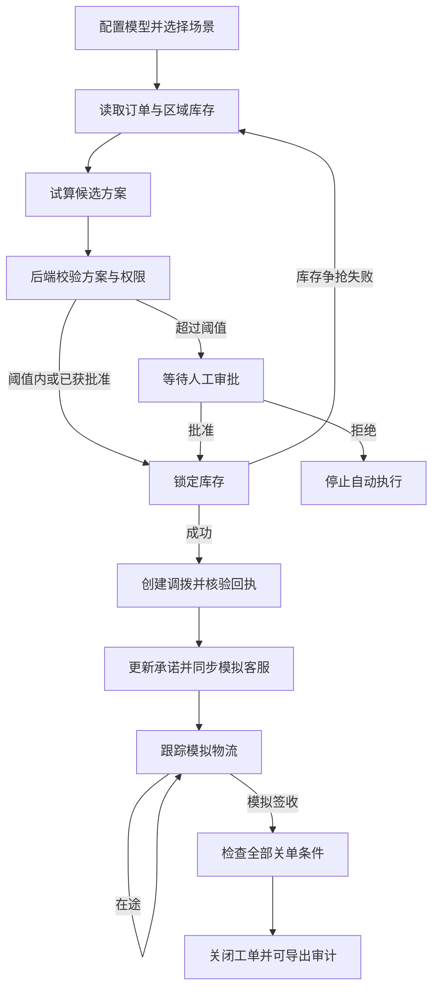

# 订单履约异常协同智能体产品需求文档

版本：V1.0

作者：杨茹睿

更新日期：2026 年 11 月 2 日

项目阶段：可运行的个人项目原型

本文描述当前原型的产品目标、业务流程和验收要求。当前版本以真实 DeepSeek 工具调用连接模拟业务工具，验证订单异常处置中的自主执行与人工审批如何协同。文中的业务问题与目标角色用于界定设计场景，尚未经过企业用户访谈或生产环境验证。

## 1 业务问题与产品目标

### 1.1 场景与问题假设

订单出现缺货后，处置者需要确认订单承诺、查找可用库存、比较调拨成本与时效，并协调审批、客服和交付跟踪。信息查询、动作执行和结果确认分布在多个环节，单独给出一段处理建议无法确认业务是否真正推进。

本项目围绕三个问题设计原型：

- 如何让模型根据最新事实选择工具，并在调用失败后调整下一步？
- 如何将费用权限、版本和关单条件交给程序校验，限制模型可执行的动作？
- 如何让操作人看清执行依据、业务回执和待审批事项，必要时接管？

### 1.2 当前版本目标

1. 跑通从订单查询到模拟签收关单的完整处置链路。
2. 展示库存争抢后的事实刷新与备选方案选择。
3. 对超阈值方案实施人工审批，批准前不锁库，拒绝后停止执行。
4. 使工具参数、回执和人工决定可查看、可导出。

当前版本不设定降本比例、效率提升或模型成功率目标。示例成本、库存和交付窗口仅用于验证规则与流程。

## 2 目标角色与使用环境

| 角色 | 主要任务 | 原型中的实现 |
| --- | --- | --- |
| 异常处置操作人 | 选择场景、观察执行、处理失败与接管 | 本机网页工作台 |
| 授权管理者 | 审核超阈值方案并填写依据 | 同一操作人扮演的模拟审批角色，无企业身份认证 |
| 项目体验者与评审者 | 理解工具调用、业务规则及人机分工 | 单步运行、执行轨迹、设计说明与审计导出 |

运行环境为本机浏览器与 Node.js 22 或更新版本。前端资源无 CDN 依赖；模型调用需要联网及有效 DeepSeek API Key。仓库不提供共享密钥或无需配置的在线服务。

## 3 版本范围与业务设定

### 3.1 已实现范围

- 单订单、单智能体、单进程内存状态。
- 真实模型选择工具与参数，后端执行模拟业务工具并回传结果。
- 常规缺货调拨、锁库失败后重选、超阈值人工审批三类场景。
- 单步、连续运行、暂停、人工接管、审批和审计 JSON 导出。
- 工具白名单、参数校验、版本检查、部分写操作幂等与关单约束。

### 3.2 不在当前范围

真实 OMS/WMS 或物流接入、真实客户通知、企业登录与角色鉴权、多订单队列、多智能体协作、数据库持久化、跨进程库存锁、生产级分布式事务和自动撤销已创建的调拨单。

### 3.3 场景参数

| 项目 | 演示设定 |
| --- | --- |
| 订单 | SO20261025-0186，需求 500 件 |
| 主仓与缺口 | 主仓可用 380 件，缺口 120 件 |
| 初始订单承诺版本 | V3 |
| 客户交付窗口 | 12 小时 |
| 候选仓 | B 昆山邻仓，初始可用 120 件、预计 6 小时；C 太仓备选仓，初始可用 120 件、预计 8 小时 |
| 常规及重选场景成本 | B 仓 360 元，C 仓 480 元 |
| 审批场景成本 | B 仓 860 元，C 仓 980 元 |
| 自动费用阈值 | 500 元，超过阈值需人工批准 |

当前方案试算是基于固定候选仓、库存和示例成本的程序计算，不是通用供应链优化求解器。模型可能选择不同的可行方案，也可能升级人工；程序不强制其每次选择最低成本方案。

## 4 核心流程与职责

模型负责选择下一项工具、生成参数和简短业务依据。程序负责计算事实、校验权限与版本、执行状态变更和确认结果。操作人负责超阈值审批、异常接管及最终审阅；模型不能代替操作人批准方案。

流程图表达业务依赖，不是预录的模型轨迹。锁库前没有有效的方案与权限校验会被拒绝；创建调拨单后仍须核验、更新承诺、同步客服并确认模拟签收，才能关闭工单。

## 5 功能需求与验收标准

以下功能均已实现；“已实现”不代表已满足生产环境要求。

| 编号 | 功能 | 行为与验收标准 |
| --- | --- | --- |
| F01 | 模型配置 | 支持输入密钥与模型名称、保存及清除内存密钥；保存时仅校验格式，鉴权及工具能力在实际调用时验证；运行期间禁止更改配置 |
| F02 | 场景创建 | 可选择三类场景并创建独立沙箱；新建不覆盖旧会话的业务资源，界面只展示当前沙箱；没有运行中的轮次时才可新建 |
| F03 | 单步执行 | 发起一次模型请求并处理该次返回的工具调用；一次返回可能有多个工具，后端逐个校验，不将“单步”等同于只执行一个工具 |
| F04 | 连续运行与暂停 | 自动发起下一轮，直到完成、待审批、拒绝、接管或错误；暂停在当前轮结束后阻止下一轮，保留当前状态 |
| F05 | 库存争抢恢复 | 重选场景中，首次锁定 B 仓时返回争抢失败且不建立库存锁；刷新库存后可重新试算 C 仓。模型直接选择 C 仓时不触发 B 仓故障 |
| F06 | 人工审批 | 超阈值方案绑定方案 ID 与当前承诺版本；等待期间禁止模型继续执行工具；审批依据必填且最多 400 字，批准后继续，拒绝后停止 |
| F07 | 人工接管 | 接管中止尚未结束的模型请求，迟到响应不再执行工具；保留订单状态与资源锁，不自动撤销已执行动作 |
| F08 | 处置闭环 | 首次物流跟踪为在途，第二次为模拟签收；未核验回执、未更新承诺、未同步客服或未签收时，关单失败 |
| F09 | 轨迹与审计 | 展示轮次、工具调用次数、服务返回的 token 统计、简短依据、参数与回执；支持导出当前会话业务状态、事件与调用记录，不导出密钥或完整模型对话 |
| F10 | 错误恢复与预算 | 模型请求失败后展示错误并允许重试；同一会话的并发执行被拒绝；配置 22 轮、32 次工具调用、20 分钟会话预算及单次 65 秒请求超时，达到执行预算时转人工 |

### 5.1 页面信息架构

- **演示工作台**：场景入口、运行控制、异常订单、库存路线、候选方案、执行轨迹、关单条件和待审批面板。
- **模型连接**：密钥及模型配置、配置状态和场景演示建议。
- **设计与演示说明**：真实与模拟部分、程序约束、三类场景与适用边界。

模拟范围在工作台直接可见。工具失败、待审批和接管状态使用文字说明，原始参数与回执通过展开查看。页面兼顾桌面操作与窄窗口阅读；1440、1100、390 像素宽度已做夹具交互检查。

## 6 工具与关键业务规则

### 6.1 工具目录

| 阶段 | 工具 | 作用 |
| --- | --- | --- |
| 观察 | `get_order`、`query_inventory` | 读取订单、承诺版本与可用库存 |
| 决策准备 | `compare_plans`、`check_authorization` | 生成候选方案，检查费用权限或提交审批 |
| 执行 | `reserve_inventory`、`create_transfer` | 锁定缺口库存，创建模拟调拨单 |
| 核验与同步 | `verify_transfer`、`update_commitment`、`notify_service` | 核验回执、更新承诺、生成模拟客服沟通草稿 |
| 跟踪与关闭 | `track_delivery`、`close_case` | 推进模拟物流并检查关单条件 |
| 补偿与交接 | `release_reservation`、`escalate_to_human` | 释放未创建调拨单的库存锁，或停止自动操作交人工 |

### 6.2 规则要求

1. 只接受白名单工具和指定字段；缺少参数、错误类型、额外字段或订单不匹配均拒绝执行。
2. 带版本的写操作必须匹配当前承诺版本。承诺更新成功后由 V3 变为 V4；已完成更新的同一请求可返回原结果，避免再次修改版本。
3. 锁库前必须存在可行方案并完成权限校验；超过阈值必须取得该方案的人工批准。
4. 重复锁库与重复创建调拨单返回已有回执，避免重复扣减或重复建单。
5. 创建调拨前可释放已有库存锁，重复释放不得再次增加库存；调拨创建后转人工核查补偿。
6. 模型文字声明不能改变业务状态。会话内两次没有工具行动会触发人工接管；当前计数按会话累计。
7. 模拟签收与真实物流签收必须区分；客服工具只生成草稿，不发送外部消息。

## 7 状态与异常处理

| 状态 | 含义 | 可继续的路径 |
| --- | --- | --- |
| `ready` | 场景已创建，尚未执行 | 单步或连续运行 |
| `active` | 处置执行中 | 继续、暂停或人工接管 |
| `awaiting_approval` | 等待超阈值方案审批 | 批准后继续，或拒绝停止 |
| `error` | 模型请求或响应处理失败 | 检查错误后重试或人工接管 |
| `human` | 自动操作已停止并交人工 | 查看并导出状态；当前界面不支持恢复自动执行 |
| `rejected` | 人工拒绝方案 | 查看并导出，不再执行 |
| `completed` | 关单条件全部满足 | 查看并导出，不再执行 |

“暂停”是前端停止下一轮的控制，不会变更业务会话为新的暂停状态。等待审批期间不能同时进行库存写操作。网页刷新不自动找回当前会话；服务重启后内存中的配置、状态和审计消失，因此需要在重启前导出。

## 8 数据与访问边界

- 密钥由本机后端使用，配置接口不回显，不写入浏览器持久存储、业务事件或审计导出。使用 `.env` 时，该文件由体验者在本机维护并排除在 Git 之外。
- 服务仅绑定回环地址，校验 Host 与请求来源，静态资源使用白名单并设置 CSP。
- 单会话保存订单快照、库存、候选方案、审批、资源锁、调拨、物流与调用事件；没有数据库或企业审计留存能力。
- 审计事件包含时间、轮次、类型、参数及结果；决策摘要是可见的简短业务依据，不是模型隐藏思维。
- 当前没有独立的管理者身份认证，网页审批只验证产品流程，不证明真实企业权限隔离。

## 9 验证与后续评估

### 9.1 当前证据

| 验证类型 | 已有结果 | 结论边界 |
| --- | --- | --- |
| 自动化业务与协议测试 | 发布前重跑 10 项，全部通过 | 验证程序规则和协议处理，使用独立 provider 夹具 |
| 浏览器交互测试 | 15 项检查通过，三种宽度无整页横向溢出，未发现脚本错误 | 验证页面与夹具流程，不证明真实模型的稳定性 |
| 真实 DeepSeek 场景验证 | 作者于 2026 年 11 月 2 日确认接入 API 后场景能够跑通 | 来自作者实测反馈；未附逐场景原始日志、模型版本或重复运行统计 |

验证来源及适用范围见 [验证记录](验证记录.md)。当前没有生产用户验证、通用成功率、效率提升或实际降本数据。

### 9.2 后续评估方案

以下为待实施的评估计划，不是已有结果：固定模型版本、提示词和场景输入，为每类场景预先规定重复次数，保存逐次审计，并记录完成率、规则拦截、人工接管、调用轮次、token 用量与耗时。失败场景单独统计是否触发 B 仓争抢分支及触发后的恢复结果，区分提前选 C 仓、失败后改选、预算停止和模型服务故障。

人工接管是可解释的停止结果，不等同于完整履约成功；模型成功说出“已完成”也不计为业务成功。业务成功以程序关单条件满足为准。

## 10 后续规划与开放问题

以下能力均未纳入当前已实现范围，需另行设计与验证：

| 优先级 | 方向 | 推进前需要解决的问题 |
| --- | --- | --- |
| P1 | 真实模型重复评估与证据归档 | 明确模型版本、场景分支、样本量、失败分类与成本预算 |
| P1 | 会话持久化与恢复 | 定义刷新、重启后的恢复入口及未完成资源锁的处理 |
| P2 | 方案试算扩展 | 支持变化的库存、窗口与成本，并定义可比较的方案质量标准 |
| P2 | 多订单与企业系统适配 | 先明确身份权限、并发资源隔离、重复请求与人工补偿机制 |

进入真实业务前，还需验证企业操作人的工作方式、审批责任、外部系统回执语义及故障补偿规则。当前原型提供的是可运行的流程与机制验证基础。
