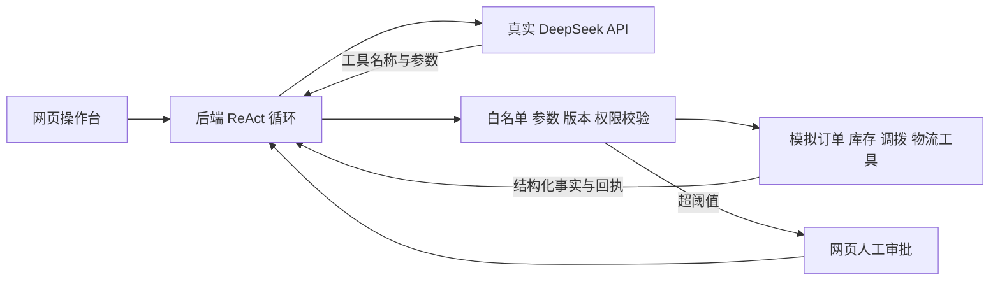

# 订单履约异常协同智能体 Demo

个人项目：面向订单缺货异常，探索大模型工具调用与业务规则、人机审批如何协同。基于 ReAct 风格的观察—决策—行动—反馈循环，实现可交互、可追溯的订单履约处置原型。

真实运行部分：模型选择工具并生成参数，后端执行工具，将结果放入下一轮模型上下文。模拟部分：订单、仓库、库存、调拨、物流、客服和管理者身份均为业务模拟沙箱，不连接企业业务系统，不发送外部消息。

## 项目文档

- [产品需求文档 PRD](PRD.md)：业务问题、目标角色、流程、功能要求、规则与验收标准。
- [验证记录](验证记录.md)：作者真实模型实测反馈、自动化测试与适用边界。
- [产品上下文](PRODUCT.md)与[界面设计说明](DESIGN.md)。

## 能力与技术栈

- 三类场景：常规缺货调拨、库存争抢后重选、超阈值人工审批。
- 13 个业务工具，由模型选择工具与参数，后端校验并执行。
- 规则控制：工具白名单、参数校验、承诺版本、写操作幂等、审批阈值与关单条件。
- 操作与追溯：单步、连续运行、暂停、人工接管、原始回执展开与审计 JSON 导出。
- 技术栈：JavaScript、Node.js 原生 HTTP、HTML/CSS、DeepSeek API / Function Calling；无第三方运行依赖。

## 启动

电脑需要 Node.js 22 或更新版本，无需安装 npm 依赖。

1. 双击 `启动Demo.cmd`，保留启动窗口。
2. 浏览器打开 [本机 Demo](http://127.0.0.1:3120/)。
3. 点击“模型连接”，填入自己的 DeepSeek API Key 并保存。
4. 回到工作台，选择场景，点击“单步执行”或“连续运行”。模型 API 调用会消耗服务额度。

密钥仅保存在本地后端内存，重启后重新输入。也可以复制 `.env.example` 为 `.env`，在本机文件内填入 `DEEPSEEK_API_KEY` 后重新启动。不要提交或发送包含密钥的 `.env`；公开仓库仅保留不含真实密钥的 `.env.example`。

命令行等价启动方式：

```powershell
node server.mjs
```

默认模型为 `deepseek-flash`；请使用账户实际可用且支持工具调用的模型。账户可用模型可能变化，可在页面填写实际模型名称。保存配置只验证格式，首次模型调用才验证鉴权、余额与工具能力。程序使用官方 `https://api.deepseek.com/chat/completions`，关闭 thinking 模式，以标准 `tool_calls` 协议循环；不展示模型隐藏思维。

## 场景演示

建议先在演示前验证真实连接，再依次展示三个场景。模型调用耗时受网络与服务影响，不承诺固定完成时长。

| 场景 | 要展示的机制 | 完成或停止条件 |
| --- | --- | --- |
| 常规缺货调拨 | 从 500 件订单、主仓 380 件和 120 件缺口出发，比较库存、成本与交付窗口，选择受控动作 | 回执核验、更新承诺、同步客服、模拟签收均完成后关闭 |
| 锁库失败后重选 | 模型选择昆山 B 仓时注入并发争抢；该次锁库返回失败，不扣减库存。模型应刷新库存并重新试算 C 仓 | 改选后完成，或模型选择升级人工；不会预录成功结果 |
| 超阈值人工审批 | 可行方案费用为 860 / 980 元，超过示例自动阈值 500 元；模型提交审批后暂停 | 操作人填审批原因，批准并继续，或拒绝停止 |

若模型在失败场景直接选 C 仓，B 仓锁库故障不会触发；这是模型实际选择的结果，可以新建此场景再次演示。提示词要求优先守住客户窗口再比较成本，但不能保证模型每次遵循最佳选择。

“单步执行”指一次模型请求以及该次返回的工具调用。模型可能返回多个调用，后端串行校验；后续工具不能假定前序成功。每个原始回执都可展开。工具中的 `decision_summary` 是简短业务依据，并非模型隐藏思维。

“暂停连续运行”在当前轮结束后停止下一轮，保留状态。“人工接管”中止尚在等待的模型请求，冻结自动操作并保留资源锁。“新建此场景”创建一个独立沙箱，旧会话不会自动释放或覆盖业务资源；当前界面只显示最新沙箱。需要保留当前演示时先导出审计 JSON。

物流工具每次推进模拟时间：第一次在途，第二次模拟签收（B 仓 6 小时、C 仓 8 小时）。不是现实时间流逝，也不是真实物流证据。创建调拨单不能直接关闭工单。

## 实现结构



- `provider.mjs`：DeepSeek 请求、超时与错误处理；固定官方地址，密钥只用于请求头。
- `agent.mjs`：系统提示、模型和工具消息循环、预算、接管与执行审计。
- `business.mjs`：模拟业务状态、13 个工具及独立规则校验。
- `server.mjs`：本机 HTTP 服务、配置、会话与导出。仅允许回环 Host 和同来源请求，只提供白名单静态文件。
- `public/`：交互界面，无 CDN 或前端网络依赖。
- `tests/`：业务约束和模型协议循环测试。

后端限制最多 22 轮、32 次工具调用、20 分钟；每次模型请求最多 65 秒。会话内累计两次没有工具行动会升级人工。请求失败后可以检查错误信息并重试。会话在内存中保存；网页刷新后不自动恢复，服务重启后会话与网页配置均消失。每次运行的工具日志可导出，导出不含密钥、隐藏思维或完整模型对话。

补偿示例仅开放“创建调拨单之前释放库存锁”；调拨单创建后禁止直接释放，需人工核对后补偿。本 Demo 不提供生产环境的分布式事务、跨进程锁、企业认证或持久审计，不能直接用于真实订单。

## 验证

```powershell
node --test tests/*.test.mjs
```

业务与协议测试使用测试夹具，验证正常履约、库存争抢、审批边界、幂等、版本冲突、关单条件、请求失败、接管以及配置/导出不泄露密钥。浏览器自动化验证也使用独立夹具服务，和真实模型服务隔离；测试夹具不作为产品运行模式暴露。

真实模型端到端验证需要配置有效密钥。作者已在本机使用真实 DeepSeek API 验证场景可以跑通；自动化测试使用独立夹具，两类结果分别记录。验证来源与限制见 [验证记录](验证记录.md)。

官方接口参考：[工具调用](https://api-docs.deepseek.com/guides/tool_calls/)、[Chat Completions](https://api-docs.deepseek.com/api/create-chat-completion/)。
